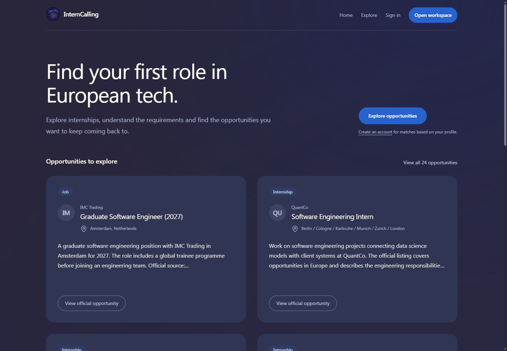
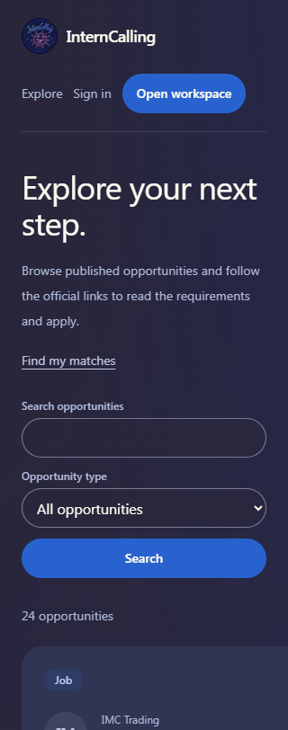
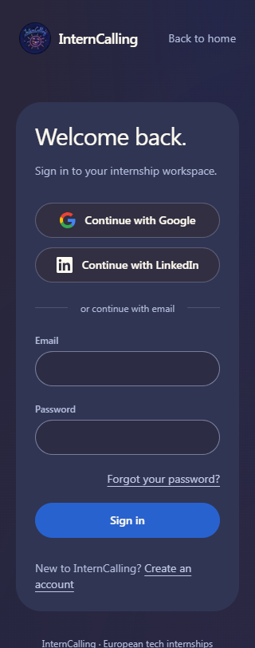

# Original InternCalling interface ? Maria review

This review publishes the original InternCalling-B3 worktree on feature/bianca-auth-onboarding, not the temporary minimal review candidate. The full sidebar, opportunity list/details, profile/settings, saved/applied read views, public catalog, responsive layouts, original rounded styling, authentication, onboarding and recovery are retained.

## Scope and reproducibility

B2 shared UI, navigation/AppShell, cards/details, semantic design tokens, branding and responsive components are included because they are absent from the branch base and required by the working interface. B3 adds Supabase SSR sessions and guards, email/password, Google/LinkedIn OAuth, profile onboarding, safe sign-in alerts and verified recovery. Apple is hidden in sign-in/signup; server provider recognition remains supported.

Public Home/Explore and protected Jobs read the existing FastAPI catalog; no new database seed/import is needed by the frontend code. A fresh environment needs a configured API/Supabase project with the existing schema and its own published opportunities; empty/unavailable services show their real empty/error states. Publication data/scripts and historical unused demo components remain local, outside this review. No backend endpoint, migration, CI, database or hosted-setting changes are included.

From apps/web use npm ci, then npm run dev. Configure your own ignored apps/web/.env.local with NEXT_PUBLIC_SUPABASE_URL, a browser-safe NEXT_PUBLIC_SUPABASE_PUBLISHABLE_KEY (or legacy NEXT_PUBLIC_SUPABASE_ANON_KEY), NEXT_PUBLIC_API_BASE_URL, and AUTH_APP_ORIGIN for recovery (local default http://localhost:3000). Never use service-role or privileged values in public variables. Backend setup remains documented in apps/api/README.md and supabase/README.md; start it from the repository root so its own ignored .env is loaded.

See [auth/onboarding](B3-auth-onboarding.md), [providers](google-sign-in.md), [recovery allowlist/template](password-recovery.md) and [rate limits](auth-rate-limits.md). No local environment values, real account details or credentials are published.

## Fresh checks on the original version ? 16 November 2026

| Check | Actual result |
| --- | --- |
| node --test tests/auth.test.mjs tests/recovery.test.mjs | 20 passed |
| npm run lint | Passed, including after browser-test endpoint parameterization |
| npm run typecheck | Passed |
| npm run build | Passed, complete original route set |
| node tests/browser-catalog.mjs | Passed against original production build on loopback 3108 and existing API |
| git diff --check | Passed |
| npm audit --omit=dev --json | 0 reported vulnerabilities |
| npm audit --json | 7 moderate development-tooling findings through TypeScript ESLint/minimatch; no high/critical |

The browser test now accepts B3_BROWSER_BASE_URL, B3_CDP_ENDPOINT and B3_SCREENSHOT_DIR, while preserving its original defaults. This allows verifying the original build without disturbing the separate candidate on port 3000. The test is read-only: actual totals/pagination, source membership, search/type filters, retired redirects, 320px layout and visible Google/LinkedIn without Apple all passed. A dedicated extension-free Edge profile was used. No hosted account or data writes were performed.

Screenshots captured and visually inspected from the original version:

These screenshots contain public opportunity listings or blank guest forms, not user profiles or credentials. Authenticated sidebar/detail screenshots still require an approved test account.

## Manual observations and pending verification

User-confirmed on the original worktree: Google/LinkedIn sign-in and refresh persistence; recovery-email delivery and callback; mismatched-password rejection; successful reset/new-password sign-in; rejection of the old password.

Temporary-candidate results (including its 24-test total and its computed-style/hydration investigation) are NOT evidence for this published version. They are not part of this PR. This original-version publication uses the fresh results above.

Pending: current full email signup/confirmation and onboarding walkthrough; fresh real two-user isolation and forbidden-access checks; expired/reused/wrong-browser recovery links and hosted password-policy rejection; cross-tab/history/revocation behavior; authenticated desktop/mobile accessibility/screenshots; deployment origin/allowlist verification. The historical synthetic browser-auth suite was not rerun during this publication and must not be reported as a fresh pass. Full dependency audit remains non-clean.

## Branch/review status

Fetched origin/develop is 64c634fcd7244ba2595e2be40c6820f063cc87d2, six commits newer than the branch base 92426f7. No merge or rebase was performed, per explicit user instruction. CI/integration with the newer target and Maria's human review remain required; no merge is authorized.

The configured remote Opportunity-Tracker-.git redirects to the renamed GitHub repository mariatimbus/InternCalling. The existing Notion tasks URL from AGENTS.md could not be resolved by connected Notion search, so no task-specific acceptance/status claim is made. Task source: https://app.notion.com/p/df1b16e458ed47b6ab74166c1b3c4a83 . No Notion status was changed.
